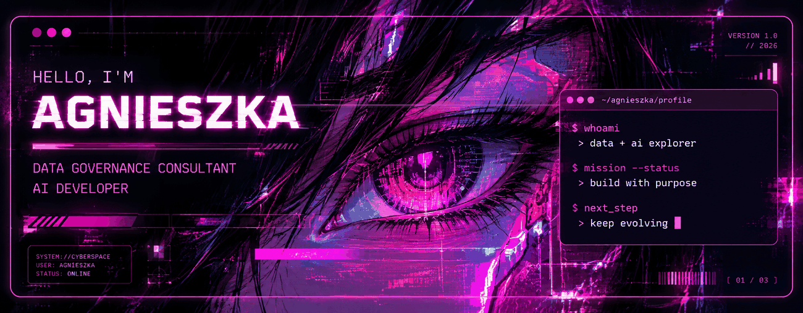

<div align="center">
  
</div>


<div align="center">
  
</div>

<br />

### `> whoami`

Hi, I'm **Agnieszka** 👋

**Data Governance Consultant & AI Developer @ Murdio**

I enjoy turning complex data into intelligent solutions, experimenting with emerging technologies, and building tools that solve real problems.

As a  **computer science student** my interests lie at the intersection of **Artificial Intelligence, Machine Learning, Data Engineering, and Cybersecurity**.

And because one field apparently wasn't enough, I'm also studying **Law**. ⚖️

### `> tech_stack`

**Languages**


**AI & Data**


**Development & Infrastructure**


### `> currently_exploring`

- 🧠 **AI & Machine Learning** from training models to practical applications
- 🔐 **Cybersecurity** AI-powered threat detection, eBPF and XDP
- 🤖 **LLMs & AI Agents** intelligent, conversational tools
- ☁️ **Cloud & Infrastructure** Linux, Docker and cloud deployments
- ⚖️ **Law & Technology** exploring where innovation meets regulation

### `> currently_building`

**`[ACTIVE PROJECT]` AI-Driven Real-Time DDoS Detection**

Exploring how **Machine Learning and eBPF** can work together to detect and mitigate network attacks in real time.


### `> system_status`

```text
[✓] SYSTEM ONLINE
[✓] CURIOSITY ENABLED
[✓] AI MODELS TRAINING
[✓] NEW IDEAS GENERATING

CURRENT MISSION:
  Building intelligent solutions.

STATUS: ALWAYS LEARNING_
```

<!--
UNCOMMENT THIS SECTION WHEN YOU ARE READY TO SHARE PROJECTS:

### `> selected_projects`

| Project | What it does | Stack |
| :-- | :-- | :-- |
| [Project name](https://github.com/YOUR_USERNAME/YOUR_REPOSITORY) | Short description | Python, ... |

OPTIONAL PUBLIC CONTACT LINKS:

### `> connect`

[LinkedIn](https://linkedin.com/in/YOUR_PROFILE) · [Portfolio](https://YOUR_WEBSITE)
-->

<br />

<div align="center">
  
</div>
